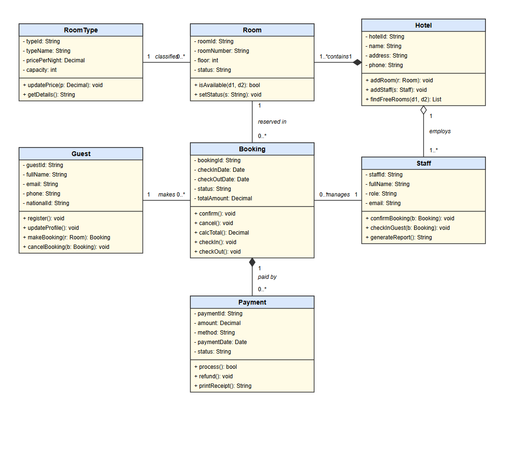

# UML Class Diagram Assignment - Hotel Booking System

**Group:** Mugisha Alain Paisible and MUCUNGUZI Felix
**Institution:** Kigali Independent University (ULK) | **Instructor:** Eric Maniraguha

## Business Idea
A hotel needs an information system to manage rooms, guests, bookings and payments.

## Scope
Covered: guest registration, rooms and room types, availability search, bookings (confirm, cancel, check-in/out), payments, staff and reports.
Excluded: online payment gateway, restaurant/spa/event management, payroll. Design only (no full application).

## Diagram

## Classes
| Class | Responsibility |
|---|---|
| Hotel | Represents the hotel; owns its rooms and employs its staff. |
| RoomType | Defines a category of room (Single, Double, Suite) with price and capacity. |
| Room | A physical room that can be booked. |
| Guest | A customer who registers and books rooms. |
| Booking | A reservation of one room by one guest for a date range. |
| Staff | Hotel employee who manages bookings and guest check-in/out. |
| Payment | A payment made for a booking (cash, mobile money, card). |

## Relationships
| From | To | Name | Type | Multiplicity |
|---|---|---|---|---|
| Hotel | Room | contains | comp | 1 : 1..* |
| RoomType | Room | classifies | assoc | 1 : 0..* |
| Guest | Booking | makes | assoc | 1 : 0..* |
| Room | Booking | reserved in | assoc | 1 : 0..* |
| Booking | Payment | paid by | comp | 1 : 0..* |
| Hotel | Staff | employs | aggr | 1 : 1..* |
| Staff | Booking | manages | assoc | 1 : 0..* |

## Structure
- documentation/report_1_project_description.pdf
- documentation/report_2_uml_class_diagram.pdf
- diagrams/uml_class_diagram.drawio, .png, .svg

## Interactive Diagram
- [View the UML class diagram in draw.io](https://viewer.diagrams.net/?lightbox=1&highlight=0000ff&edit=_blank&layers=1&nav=1&title=uml_class_diagram.drawio#Uhttps%3A%2F%2Fraw.githubusercontent.com%2Fmap-boy%2Fuml-class-diagram-assignment%2Fmain%2Fdiagrams%2Fuml_class_diagram.drawio)
- [Edit in draw.io](https://app.diagrams.net/#Uhttps%3A%2F%2Fraw.githubusercontent.com%2Fmap-boy%2Fuml-class-diagram-assignment%2Fmain%2Fdiagrams%2Fuml_class_diagram.drawio)
